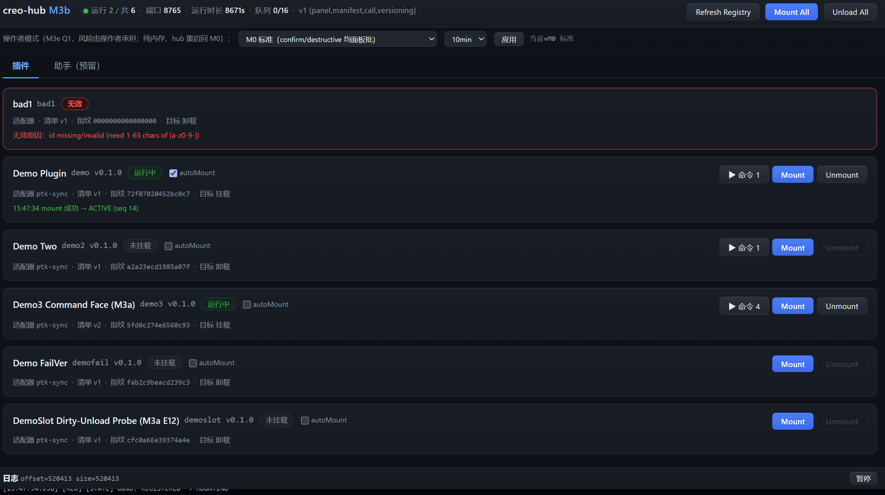
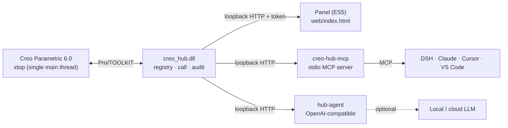

# CreoHub

**Unofficial community tooling for Creo Parametric — not affiliated with, endorsed by, or sponsored by PTC Inc.**

[](https://github.com/poirotzheng/creo-hub/actions/workflows/ci.yml)
[](LICENSE)
[](https://github.com/poirotzheng/creo-hub/releases)

creo-hub is a **plugin host and management plane for Creo Parametric 6.0**.
It registers once with Creo, then lets you scan, mount, unmount, update and
roll back Pro/TOOLKIT plugins **at runtime** — no more editing `protk.dat` and
restarting Creo for every plugin.

Every plugin capability is a **declared command** with a JSON schema, a risk
level (`safe` / `confirm` / `destructive`) and an audit trail. Creo-hub exposes
those commands over a token-protected loopback API, so panels, scripts and AI
assistants (via MCP) can drive deterministic operations — never generated
geometry.



## Why creo-hub

| Problem | creo-hub |
|---|---|
| Each plugin needs its own `protk.dat` entry and a Creo restart | One host registration; plugins are mounted/unmounted at runtime |
| Plugin capabilities are opaque DLL exports | `plugin.json` v2 declares commands, schemas, risk, timeouts, undo |
| Automation can accidentally mutate a model | Risk gate + nonce approval + `dryRun` + audit log |
| AI tools either can't reach CAD or hallucinate geometry | MCP bridge exposes only deterministic, declared commands |
| Air-gapped sites can't use cloud tooling | Loopback-only, zero external assets, local LLM option |

## Architecture



The hub DLL never talks to an LLM. API keys live only in the bridge/agent
configuration.

## Features

- **Runtime registry**: scan `plugins\`, mount/unmount, dependency reconcile
  (`requires`), versioned pointer packages with `update`/`rollback`, seven-state
  machine, quarantine for broken packages.
- **Command plane**: `POST /api/v1/call` + schema validation + risk gate +
  two-step nonce confirmation + `dryRun` + orphan-safe timeouts + `async:true`
  jobs with progress polling + `undoCommand`.
- **Panel**: status cards, badges, approval drawer, job bar, assistant chat tab.
- **MCP bridge**: management tools (`status` / `plugins` / `manifest` / `log` /
  `mount` / `unmount`), `creo_hub_call`, `creo_hub_job`, plus dynamic
  first-class tools for every declared plugin command.
- **Local assistant**: OpenAI-compatible loopback agent, on-prem friendly,
  `toolMode` native or JSON fallback.
- **SDK + toolchain**: two-file SDK (`sdk/hub_sdk.{c,h}`), template, scaffold,
  manifest lint, self-test, pack (zip + SHA-256), install/uninstall/doctor.
- **Quality**: 30 gate runners (registry, state, reconcile, call, nonce,
  version, HTTP API, log, SDK, manifest, pack, installer, panel, agent, tool
  contract, Win7 static, geometry invariants), most run offline.

## Requirements

| Item | Requirement |
|---|---|
| Creo | **Creo Parametric 6.0** (verified). Creo 7+ is not supported yet. |
| PTC license | A **Pro/TOOLKIT license option** is required to build and run plugins. Distributed Pro/TOOLKIT applications must be unlocked with `protk_unlock`; see [PTC CS28242](https://www.ptc.com/cn/support/article/28242?art_lang=en&as=0). |
| OS | Windows 10 x64 (verified). A Windows 7 SP1 build profile exists but is **not verified on real hardware**. |
| Build | Visual Studio 2017/2022 (C++ desktop workload), PTC TOOLKIT SDK headers/libs |
| Optional runtime | Node.js 18+ (bridge, agent, tooling), Inno Setup 6.3.3 (installer) |

> **Open source ≠ free PTC license.** You still need a licensed Creo installation
> and a TOOLKIT license option. The repository contains **no** PTC headers,
> import libraries, or Creo binaries.

## Quick start

### A. Install from a release

1. Download `creo-hub-1.0.0-setup.exe` (or the zip matching your OS) from
   [Releases](https://github.com/poirotzheng/creo-hub/releases) and verify
   `SHA256SUMS.txt`.
2. Run the installer (per-user, no admin required). It registers the hub and
   writes one `PROTKDAT` line; plugins stay managed by the hub.
3. Start Creo — the hub loads automatically. Open
   `http://127.0.0.1:8765/?token=<token>`; the token is in `hub_token.txt`.
4. Drop a plugin package into `plugins\<id>\`, press **Refresh**, then **Mount**.

### B. Build from source

```bat
git clone https://github.com/poirotzheng/creo-hub.git
cd creo-hub

rem point at your Pro/TOOLKIT SDK (or copy local.env.example to local.env)
set CREO_TOOLKIT_ROOT=C:\Program Files\PTC\Creo 6.0.0.0\Common Files\protoolkit

build\build.cmd
test\run_all.cmd
deploy\install.cmd
```

Outputs land in `build\out\`; the installer payload is produced by
`deploy\release_pack.cmd`.

## Plugin model

```
plugins\<id>\
├─ plugin.json          # manifest v2: id, version, commands[], risk, schemas
├─ bin\<id>.dll         # Pro/TOOLKIT DLL exporting hub_cmd
└─ text\text\usascii\   # UI messages (Creo resource path)
```

A minimal command declaration:

```json
{
  "manifestVersion": 2,
  "id": "hello",
  "name": "Hello",
  "adapter": "ptk-sync",
  "currentVersion": "0.1.0",
  "commands": [
    { "name": "hello.ping", "risk": "safe", "descForLLM": "Return pong", "inputSchema": { "type": "object" } }
  ]
}
```

See the developer guide and `tools\plugin_tpl\`.

## MCP / AI integration

`bridge\bridge.mjs` is a standard stdio MCP server. Example (Claude Desktop /
Cursor style):

```json
{
  "mcpServers": {
    "creohub": {
      "command": "cmd",
      "args": ["/c", "node", "<REPO_ROOT>\\bridge\\bridge.mjs"],
      "env": { "CREO_HUB_ROOT": "<REPO_ROOT>" }
    }
  }
}
```

DSH users: see `integrations\dsh\README.md` for a `cordis.patch.yml` template
and an optional bundle. The tool surface is **dynamic**: it follows the live
plugin manifest (`tools/list_changed`).

## Security

- Loopback only (`127.0.0.1`), bearer token per request, Origin/Host checks.
- Risk gate: `confirm` / `destructive` require a human approval in the panel
  (nonce, short TTL); `safe` commands are read-only by contract.
- `dryRun` previews validation and gate decisions without executing.
- Append-only audit log for mount/unmount/call, with command digest.
- The hub DLL has no outbound network access; keys stay in bridge/agent config.
- No telemetry, no CDN, no third-party JS in the panel.

Details: `SECURITY.md`.

## Repository map

| Path | What |
|---|---|
| `src\hub\` | Host DLL: registry, state machine, call plane, HTTP, audit, jobs |
| `src\demo*\` | Example plugins (command face, geometry probe, dirty-unload) |
| `sdk\` | Two-file plugin SDK |
| `tools\` | Template, scaffold, manifest lint, pack, version/path checks |
| `deploy\` | Install/uninstall/doctor/release packing, Inno installer |
| `bridge\` | MCP stdio bridge |
| `agent\` | Local OpenAI-compatible assistant |
| `web\` | Single-file ES5 panel |
| `plugins\` | Installed plugin packages |
| `test\` | 30 gate runners + fixtures |
| `docs\` | User guide, developer guide, architecture, history |
| `integrations\` | DSH / Claude / Cursor configs |
| `skills\` | DSH skill for plugin onboarding |

## Documentation

- [User guide](docs/40_creohub安装与使用教程.md) (Chinese)
- [Developer guide](docs/18_插件开发者指南.md) (Chinese)
- [Known limitations](docs/known-limitations.md)
- [Roadmap](ROADMAP.md)
- [Changelog](CHANGELOG.md)

## License and trademarks

Source code: [Apache License 2.0](LICENSE). Documentation: [CC BY 4.0](docs/LICENSE).
Third-party notices: [THIRD-PARTY-NOTICES.md](THIRD-PARTY-NOTICES.md).

Creo® is a trademark of PTC Inc. creo-hub is an independent open-source project
and is not affiliated with, endorsed by, or sponsored by PTC Inc. See
[TRADEMARKS.md](TRADEMARKS.md).

## Contributing

Issues and pull requests are welcome — see [CONTRIBUTING.md](CONTRIBUTING.md)
and [CODE_OF_CONDUCT.md](CODE_OF_CONDUCT.md). Security reports: [SECURITY.md](SECURITY.md).
