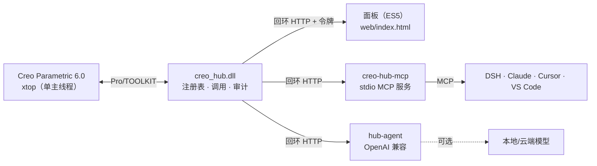

# creo-hub

**面向 Creo Parametric 的社区开源工具（非 PTC 官方项目，与 PTC 无隶属或背书关系）。**

[](https://github.com/poirotzheng/creo-hub/actions/workflows/ci.yml)
[](LICENSE)
[](https://github.com/poirotzheng/creo-hub/releases)

creo-hub 是 **Creo Parametric 6.0 的插件宿主与管理面**：Creo 只需注册一次 hub，
之后即可在运行时扫描、挂载、卸载、更新、回滚 Pro/TOOLKIT 插件——不必再为每个
插件改 `protk.dat`、重启 Creo。

每个插件能力都是一条**声明式命令**：带 JSON Schema、风险等级（`safe` /
`confirm` / `destructive`）与审计记录。creo-hub 通过令牌保护的本地回环 API 暴露
这些命令，面板、脚本与 AI 助手（经 MCP）都只驱动**确定性命令**，不生成几何。


## 为什么需要它

| 痛点 | creo-hub 的做法 |
|---|---|
| 每个插件都要一条 `protk.dat` + 重启 Creo | hub 一次注册；插件运行时装卸 |
| 插件能力是不透明的 DLL 导出 | `plugin.json` v2 声明命令、Schema、风险、超时、undo |
| 自动化误改模型 | 风险闸门 + nonce 人工批准 + `dryRun` + 审计 |
| AI 够不到 CAD，或乱生成几何 | MCP 桥只暴露声明过的确定性命令 |
| 内网/气隙环境无法用云工具 | 回环-only、零外部资源、可接本地模型 |

## 架构



hub DLL 永不外连 LLM；API key 只存在桥/agent 进程侧。

## 能力

- **运行时注册表**：扫描 `plugins\`、装卸、依赖调和（`requires`）、指针包
  `update`/`rollback`、七态状态机、坏包隔离。
- **命令面**：`POST /api/v1/call` + Schema 校验 + 风险闸门 + nonce 两段式确认 +
  `dryRun` + 超时孤儿协议 + `async:true` 长任务进度 + `undoCommand`。
- **面板**：状态卡、徽章、批准抽屉、任务条、助手对话 tab。
- **MCP 桥**：管理工具（`status`/`plugins`/`manifest`/`log`/`mount`/`unmount`）、
  `creo_hub_call`、`creo_hub_job`，以及每条插件命令动态生成的一级工具。
- **本地助手**：OpenAI 兼容、回环、内网友好，`toolMode` 支持 native/JSON 回退。
- **SDK + 工具链**：两文件 SDK、模板、脚手架、清单 lint、自测、打包
  （zip + SHA-256）、安装/卸载/体检。
- **质量**：30 个门（注册表/状态机/调和/调用/nonce/版本/HTTP/日志/SDK/清单/
  打包/安装器/面板/助手/工具契约/Win7 静态/几何不变量），多数可离线跑。

## 环境要求

| 项 | 要求 |
|---|---|
| Creo | **Creo Parametric 6.0**（已验证）；暂不支持 Creo 7+ |
| PTC 授权 | 编译/运行插件需要 **Pro/TOOLKIT license option**；分发的 PTK 应用须用 `protk_unlock` 解锁（见 [PTC CS28242](https://www.ptc.com/cn/support/article/28242?art_lang=en&as=0)） |
| 操作系统 | Windows 10 x64（已验证）；Win7 SP1 构建档存在但**未实机验证** |
| 构建 | Visual Studio 2017/2022（C++ 桌面负载）、PTC TOOLKIT SDK 头/导入库 |
| 可选运行时 | Node.js 18+（桥/助手/工具链）、Inno Setup 6.3.3（安装器） |

> **开源 ≠ 免 PTC 授权**：仍需合法 Creo 与 TOOLKIT 授权。仓库**不含**任何 PTC
> 头文件、导入库或 Creo 二进制。

## 快速开始

### A. 用发行包安装

1. 从 [Releases](https://github.com/poirotzheng/creo-hub/releases) 下载
   `creo-hub-1.0.0-setup.exe`（或对应系统 zip），用 `SHA256SUMS.txt` 校验；
2. 运行安装器（按用户安装，无需管理员）；它注册 hub 并写入一行 `PROTKDAT`；
3. 启动 Creo，hub 自动加载；打开 `http://127.0.0.1:8765/?token=<令牌>`
   （令牌在 `hub_token.txt`）；
4. 把插件包放进 `plugins\<id>\`，面板点 **Refresh** → **Mount**。

### B. 从源码构建

```bat
git clone https://github.com/poirotzheng/creo-hub.git
cd creo-hub

rem 指向你的 Pro/TOOLKIT SDK（或复制 local.env.example 为 local.env）
set CREO_TOOLKIT_ROOT=C:\Program Files\PTC\Creo 6.0.0.0\Common Files\protoolkit

build\build.cmd
test\run_all.cmd
deploy\install.cmd
```

产物在 `build\out\`；安装载荷由 `deploy\release_pack.cmd` 生成。

## 插件模型

```
plugins\<id>\
├─ plugin.json          # v2 清单：id、版本、commands[]、risk、schema
├─ bin\<id>.dll         # 导出 hub_cmd 的 Pro/TOOLKIT DLL
└─ text\text\usascii\   # UI 资源（Creo 资源路径）
```

最小命令声明见英文 README 或 `tools\plugin_tpl\`。

## MCP / AI 接入

`bridge\bridge.mjs` 是标准 stdio MCP 服务。示例（Claude Desktop / Cursor 风格）：

```json
{
  "mcpServers": {
    "creohub": {
      "command": "cmd",
      "args": ["/c", "node", "<REPO_ROOT>\\bridge\\bridge.mjs"],
      "env": { "CREO_HUB_ROOT": "<REPO_ROOT>" }
    }
  }
}
```

DSH 用户见 `integrations\dsh\README.md`（`cordis.patch.yml` 模板与可选 bundle）。
工具面是**动态的**：跟随实时插件清单（`tools/list_changed`）。

## 安全模型

- 仅回环（`127.0.0.1`）、每请求令牌、Origin/Host 校验；
- 风险闸门：`confirm`/`destructive` 需面板人工批准（nonce、短 TTL），
  `safe` 按契约只读；
- `dryRun` 只做校验与闸门预演，不执行；
- 挂载/卸载/调用全程审计（含参数摘要）；
- hub DLL 零外连；面板零 CDN、零第三方 JS；无遥测。

详见 `SECURITY.md`。

## 目录地图

| 路径 | 内容 |
|---|---|
| `src\hub\` | 宿主 DLL：注册表、状态机、调用面、HTTP、审计、任务 |
| `src\demo*\` | 示例插件（命令面、几何探针、脏卸载） |
| `sdk\` | 两文件插件 SDK |
| `tools\` | 模板、脚手架、清单 lint、打包、版本/路径检查 |
| `deploy\` | 安装/卸载/体检/发行打包、Inno 安装器 |
| `bridge\` | MCP stdio 桥 |
| `agent\` | 本地 OpenAI 兼容助手 |
| `web\` | 单文件 ES5 面板 |
| `plugins\` | 已安装插件包 |
| `test\` | 30 个门 + fixtures |
| `docs\` | 用户/开发/架构/历史文档 |
| `integrations\` | DSH / Claude / Cursor 配置 |
| `skills\` | DSH 插件接入 skill |

## 文档

- [安装与使用教程](docs/40_creohub安装与使用教程.md)
- [插件开发者指南](docs/18_插件开发者指南.md)
- [已知限制](docs/known-limitations.md)
- [路线图](ROADMAP.md) ｜ [变更日志](CHANGELOG.md)

## 许可与商标

代码：[Apache License 2.0](LICENSE)；文档：[CC BY 4.0](docs/LICENSE)；
第三方声明：[THIRD-PARTY-NOTICES.md](THIRD-PARTY-NOTICES.md)。

Creo® 是 PTC Inc. 的商标。creo-hub 是独立开源项目，与 PTC 无隶属、背书或赞助
关系，详见 [TRADEMARKS.md](TRADEMARKS.md)。

## 贡献

欢迎 issue 与 PR——见 [CONTRIBUTING.md](CONTRIBUTING.md) 与
[CODE_OF_CONDUCT.md](CODE_OF_CONDUCT.md)；安全问题走 [SECURITY.md](SECURITY.md)。
